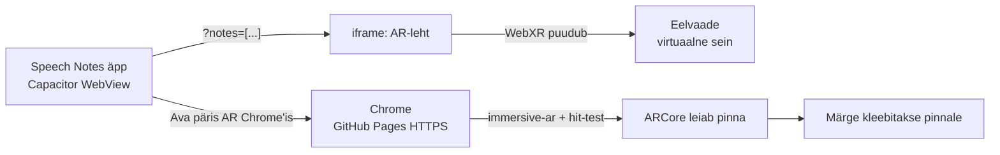

# AR-leht: sticky notes ruumis

Speech Notes rakendusele lisatud liitreaalsuse (AR) leht, kus kasutaja saab oma häälmärkmeid "kleepida" päris ruumi pindadele: lauale, seinale või põrandale. Märkme tekst tuleb rakendusest, nii et dikteeritud märge muutub ruumis paiknevaks kleepmärkmeks.

Rakenduse **AR-vaates** on kaks režiimi:

| Režiim | Tehnoloogia | Mida teeb | Kus töötab |
|---|---|---|---|
| **Markerless (WebXR)** | WebXR Device API (`immersive-ar`, `hit-test`, `dom-overlay`) + Three.js | Leiab kaamerapildist pinna ja kleebib puudutuse kohale märkme | Chrome ARCore'i toega Android-telefonis, HTTPS-i kaudu |
| **Marker** | A-Frame 1.6 + AR.js 3.4 | Näitab Hiro-markeri peal märget | Rakenduse sees, brauseris, veebikaameraga arvutis |

**Omapärane element:** kuubiku asemel on objektiks kleepmärge, mille tekst on kasutaja enda märge. Märkme tekst joonistatakse canvasele ja kasutatakse tekstuurina. Märge pöördub pinna järgi: laual lamab ta, tekst kasutaja poole, seinal seisab püsti. Igal märkmel on kerge juhuslik kalle ja paigutamisel väike "hüpe" (`easeOutBack` animatsioon). Kasutaja valib märkme värvi ja enne paigutamist näitab poolläbipaistev "kummitusmärge", kuhu märge läheb.

---

## Failid

```
speech-notes/
├── src/ar/webxr-ar.html     # markerless AR (WebXR) – sticky notes
├── src/ar/aframe-ar.html    # markeriga AR (A-Frame + AR.js)
├── src/main.ts              # AR-vaade äpis, märkmete edastamine AR-lehele
├── index.html               # AR-vaate segment, iframe ja "Ava päris AR Chrome'is" nupp
└── vite.config.ts           # kopeerib AR-lehed build'i kausta dist/ar/
.github/workflows/ar-pages.yml  # avaldab AR-lehed GitHub Pages'i (HTTPS)
```

## Arhitektuur



Rakendus annab viimased (kuni 8) märget AR-lehele URL-i parameetrina `?notes=["...","..."]`. Rakenduse sees avaneb AR-leht iframe'is. Kuna WebView ei toeta WebXR-i (vt allpool), näitab leht seal eelvaadet. Nupp **"Ava päris AR Chrome'is"** avab sama lehe GitHub Pages'ist Chrome'is, kus töötab päris AR.

---

## Kuidas see tehti

### 1. Lähtepunkt: kuubiku demo
Alguses oli rühmas tehtud WebXR-i näidis, mis paigutas pinnale kuubiku (`BoxGeometry` + `MeshNormalMaterial`). Sellest jäi alles WebXR-i karkass:
- Three.js `WebGLRenderer` koos `renderer.xr.enabled = true` ja `local` reference space'iga
- sessiooni küsimine `immersive-ar` režiimis (`hit-test` kohustuslik, `dom-overlay` valikuline)
- `viewer` ja `local` reference space'id ning `requestHitTestSource`
- animatsioonitsükkel, mis loeb igas kaadris `getHitTestResults()` ja liigutab rohelist rõngast
- `select` sündmus (ekraani puudutus) objekti paigutamiseks
- sessiooni lõpetamise ja vigade käsitlemine, `isSessionSupported()` kontroll

Juurde ehitati järgmised osad:
- `placeCube()` asendati funktsiooniga `placeNote()` ja kuubiku asemel tehakse tekstuuriga tasapind
- pinna normaali lugemine ja märkme pööramine pinna järgi (`placeOnSurface()`)
- kummitusmärge, värvivalik, oma teksti sisestamine ja "Võta tagasi"
- märkmed tulevad äpist URL-i kaudu
- eelvaate režiim seadmetele, kus WebXR-i pole
- `beforexrselect`, et puudutused nuppudel ei paigutaks märget

### 2. Pinna leidmine (hit-test)
Igas kaadris saadetakse kiir telefoni keskelt ette. ARCore tagastab koha, kus see pinda tabab. Hit-testi poosi Y-telg on pinna normaal, mille järgi saab aru, kas tegu on laua või seinaga.

```js
renderer.setAnimationLoop((now, frame) => {
  const hits = frame.getHitTestResults(hitTestSource);
  const pose = hits.length ? hits[0].getPose(localSpace) : null;
  const viewer = frame.getViewerPose(localSpace);
  if (pose && viewer) {
    _m.fromArray(pose.transform.matrix);
    _m.decompose(target.position, _q, _s);
    target.normal.copy(UP).applyQuaternion(_q); // pinna normaal
    target.valid = true;
    placeOnSurface(ghost, target.position, target.normal, target.cameraPos);
  }
  animatePlaced(now);
  renderer.render(scene, camera);
});
```

### 3. Märkme asend pinnal
```js
function placeOnSurface(mesh, position, normal, cameraPos, tilt = 0) {
  _normal.copy(normal).normalize();
  mesh.position.copy(position).addScaledVector(_normal, 0.002); // 2 mm pinnast, et ei vilguks
  if (_normal.y > 0.7) {
    // horisontaalne pind: märge lamab, teksti ülaserv kaamerast eemale
    const yaw = Math.atan2(-(position.x - cameraPos.x), -(position.z - cameraPos.z));
    mesh.rotation.set(-Math.PI / 2, yaw, tilt, 'YXZ');
  } else {
    // sein: märge vaatab seinast välja
    const yaw = Math.atan2(_normal.x, _normal.z);
    mesh.rotation.set(0, yaw, tilt, 'YXZ');
  }
}
```

### 4. Märge ise: tekst tekstuurina
Tekst joonistatakse 512×512 canvasele. Font läheb väiksemaks, kuni tekst ära mahub, ja canvasest saab `THREE.CanvasTexture`. Märkme suurus ruumis on 15 × 15 cm.

```js
function makeNoteMesh(text, color, opacity = 1) {
  const material = new THREE.MeshBasicMaterial({
    map: makeNoteTexture(text, color), side: THREE.DoubleSide,
    transparent: opacity < 1, opacity,
  });
  return new THREE.Mesh(noteGeometry, material);
}
```

### 5. Märkmed äpist AR-lehele (`main.ts`)
```ts
function arNotesQuery(): string {
  const texts = notes.map((n) => n.text.trim()).filter(Boolean).slice(0, 8).map((t) => t.slice(0, 160));
  return texts.length ? `?notes=${encodeURIComponent(JSON.stringify(texts))}` : '';
}

arOpenChrome.addEventListener('click', () => {
  const url = `${AR_PAGES_URL}webxr-ar.html${arNotesQuery()}`;
  if (Capacitor.isNativePlatform()) window.location.href = url; // Capacitor avab välise brauseri
  else window.open(url, '_blank');
});
```

---

## Mis oli lihtne, mis keeruline

**Lihtne**
- Three.js-i WebXR-i tugi: `renderer.xr.setSession()` hoolitseb kaamerapildi ja vaate maatriksite eest.
- Kuubiku demost sticky notes'i tegemine. Hit-testi karkass jäi samaks, vahetus ainult see, mida paigutatakse.
- Teksti joonistamine canvasele ja selle kasutamine tekstuurina.

**Keeruline**
- **WebXR ei tööta Capacitori äpi sees.** Capacitor kuvab rakendust Androidi WebView's ja WebView'l puudub WebXR API (`navigator.xr` on `undefined`). Esialgu tundus, et viga on meie koodis. Lahendus: päris AR avatakse Chrome'is ja äpi sees näidatakse eelvaadet.
- **Emulaator ei sobi WebXR AR-i testimiseks.** `immersive-ar` vajab ARCore'i, päris kaamerapilti ja liikumisandureid.
- **HTTPS-i nõue.** WebXR töötab ainult turvalises kontekstis (HTTPS või `localhost`), seega ei saa telefonis avada dev-serverit IP-aadressi kaudu (`http://192.168.x.x`). Lahendus: AR-lehed avaldatakse GitHub Actionsiga GitHub Pages'i.
- **npm sõltuvuste konflikt.** `vite-plugin-static-copy@0.2.0` toetas ainult Vite 2-te, aga projektis on Vite 8, mistõttu `npm install` andis `ERESOLVE` vea. Lahendus: plugin uuendati versioonile 4.x. `--force` ja `--legacy-peer-deps` jäeti kasutamata, sest need peidavad vea ainult ära.
- **Uus pluginaversioon muutis väljundi struktuuri.** v3+ jätab kaustastruktuuri alles ja failid läksid kausta `dist/ar/src/ar/`, mistõttu iframe ei leidnud lehte üles. Lahendus: `rename: { stripBase: true }`.
- **`npm audit`.** `npm audit fix` parandas ohutult parandatavad haavatavused. Allesjäänud moderate-taseme hoiatused on `@capacitor/cli` → `rimraf` → `glob` ahelas, ainult arenduse tööriistas. `npm audit fix --force` oleks viinud Capacitor CLI tagasi versioonile 4, seega jäeti see tegemata.
- **Markeri AR ei laadinud.** Vana näide laadis AR.js-i aadressilt `cdn.rawgit.com`, mis suleti 2019. Uuendatud A-Frame 1.6 + AR.js 3.4 peale (jsDelivr CDN).
- **Täpitähed.** A-Frame'i vaikefont ei sisalda õ, ä, ö, ü tähti, seega joonistatakse ka markeri versioonis tekst canvasele.
- **Puudutused läbi nuppude.** `dom-overlay` režiimis käivitab nupuvajutus ka WebXR-i `select` sündmuse. Lahendus: `beforexrselect` + `preventDefault()` UI kaartidel.

---

## Ehitamine ja käivitamine

### Eeldused
- Node.js ja npm
- Android Studio
- Päris AR-i jaoks ARCore'i toega Android-telefon ([toetatud seadmete nimekiri](https://developers.google.com/ar/devices)), kuhu on installitud **Google Play Services for AR** ja **Chrome**

### Rakendus
```bash
cd speech-notes
npm install
npm run build
npx cap sync android
npx cap open android   # Android Studios: vali seade/emulaator ja Run
```

### AR-lehtede avaldamine (ühekordne)
1. GitHub → **Settings → Pages → Source: GitHub Actions**
2. Pushi `main` harusse. Workflow `ar-pages.yml` avaldab `speech-notes/src/ar` kausta.
3. Leht on aadressil: `https://coolysn.github.io/Mobiilirakenduste_arendamine/webxr-ar.html`

### Füüsilisel seadmel
1. Luba telefonis arendaja valikud ja USB-silumine ning ühenda telefon USB-kaabliga.
2. Android Studios vali oma telefon ja vajuta Run.
3. Äpis ava **Augmented Reality → Markerless (WebXR)** ja vajuta **"Ava päris AR Chrome'is"**.
4. Chrome'is vajuta **Alusta AR-i**, luba kaamera ja liiguta telefoni aeglaselt pinna kohal, kuni ilmub roheline rõngas. Seejärel puuduta ekraani.
5. Markeri režiimi jaoks ava äpis **Marker** ja näita kaamerale [Hiro markerit](https://raw.githubusercontent.com/AR-js-org/AR.js/master/data/images/hiro.png).

### Emulaatoris
Android Studio emulaatoris käivitub äpp tavaliselt. AR-vaates näitab WebXR leht **eelvaadet**: virtuaalset seina, kuhu saab hiirega märkmeid kleepida. Päris AR emulaatoris ei tööta (vt "Keeruline").

### Arvutis brauseris
```bash
npm run dev
```
Ava `http://localhost:5173`. WebXR leht näitab eelvaadet. Markeri režiim töötab veebikaameraga.

---

## AR-funktsionaalsuse kontrollimine

### Testimise sammud

| # | Test | Oodatav tulemus | Tulemus |
|---|---|---|---|
| 1 | `npm run build` | Build õnnestub, `dist/ar/` kaustas on `webxr-ar.html` ja `aframe-ar.html` | ☐ |
| 2 | Äpp emulaatoris → AR → Markerless | Eelvaade avaneb, äpi märkmed on valikus, klõps seinal kleebib märkme | ☐ |
| 3 | Äpp telefonis → AR → Marker | Kaamera avaneb, Hiro-markeril on märge täpitähtedega tekstiga | ☐ |
| 4 | "Ava päris AR Chrome'is" | Chrome avab GitHub Pages lehe, märkmed on kaasas | ☐ |
| 5 | Chrome → Alusta AR-i | Kaamerapilt, pinna leidmisel roheline rõngas ja kummitusmärge | ☐ |
| 6 | Puudutus laual | Märge lamab laual, tekst kasutaja poole | ☐ |
| 7 | Puudutus seinal | Märge seisab seinal püsti | ☐ |
| 8 | Nupud AR-is (värv, "Võta tagasi") | Nupud töötavad ega paiguta kogemata märget | ☐ |
| 9 | Liikumine ruumis | Märkmed püsivad oma kohal, ei "uju" | ☐ |

### Silumine ja profiilimine
- **Chrome remote debugging:** ühenda telefon USB-ga ja ava arvutis `chrome://inspect`. Sealt näeb telefoni Chrome'i konsooli (veateated, `navigator.xr` olemasolu) ja saab salvestada **Performance** profiili FPS-i jälgimiseks.
- **WebView silumine:** samast `chrome://inspect` vaatest leiab ka äpi WebView. Seal saab kontrollida, et `navigator.xr` on `undefined`, mis kinnitab, miks AR äpi sees ei tööta.
- **Android Studio Profiler:** CPU ja mälu kasutus AR-vaates.
- AR-leht kirjutab oleku ekraanile (`#status`), näiteks "Pinda pole veel leitud" või "See seade ei toeta immersive-ar režiimi", mis aitab testimisel aru saada, mis seisus sessioon on.

### Tähelepanekud testimisest
_Täita pärast testimist: seade, Androidi versioon, mis töötas, mis mitte, FPS._

---

## Allikad
- [MDN: WebXR Device API](https://developer.mozilla.org/en-US/docs/Web/API/WebXR_Device_API)
- [Google ARCore: Hello WebXR](https://developers.google.com/ar/develop/webxr/hello-webxr)
- [Three.js dokumentatsioon](https://threejs.org/docs/)
- [AR.js](https://github.com/AR-js-org/AR.js)
- [Capacitor dokumentatsioon](https://capacitorjs.com/docs)
- [vite-plugin-static-copy](https://github.com/sapphi-red/vite-plugin-static-copy)
